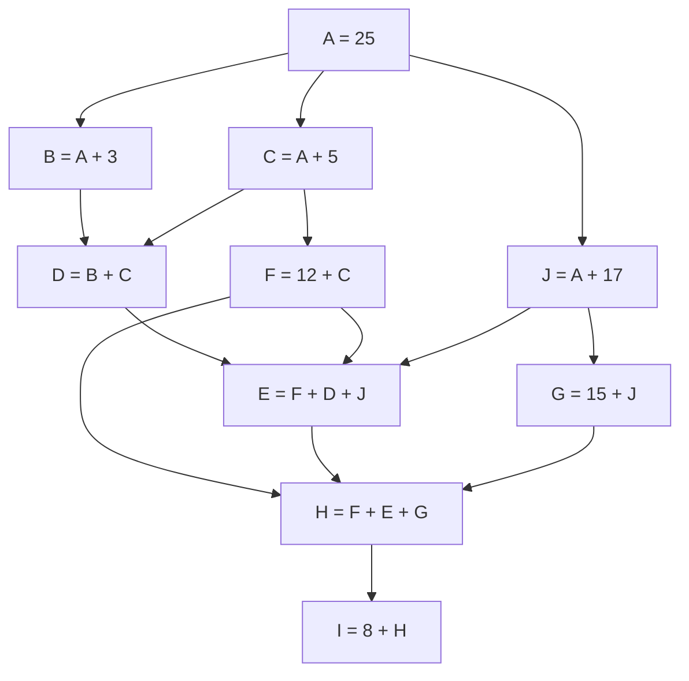

The main thread starts each worker only when all required input data is available. Operations are labeled alphabetically from A to J:

- A = 25
- B = A + 3
- C = A + 5
- D = B + C
- E = F + D + J
- F = 12 + C
- G = 15 + J
- H = F + E + G
- I = 8 + H
- J = A + 17

Results are displayed alphabetically, while execution follows the operation dependencies.

## Precedence graph

